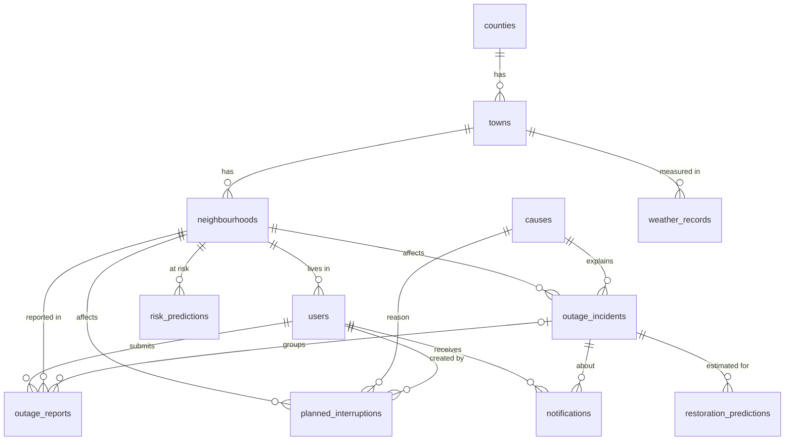

User (customers and admins)
Location (counties, towns, neighbourhoods)
Outage report (what one customer says happened)
Outage incident (the real event that many reports may point to)
Cause (transformer failure, cable fault, weather, and so on)
Notification (a message sent to a user)
Weather record (rainfall and storms in an area at some time)
Planned interruption (announced maintenance)
Prediction (an estimated restoration time, saved with its confidence)

User Table:
Id                                 - Primary key
first_name, last_name              - Your “two names”;
email (unique), phone              - How the person can be reached and can log in
password_hash                      - Scrambled password, never the real one
role                               - customer or admin
neighbourhood_id                   - Foreign key to neighbourhoods
notify_sms, notify_email           - Notification choices
created_at                         - When the account was made

County         Town                      Neighbourhood 
id             id                        id
Name           county_id(foreign key)    name of Neighbourhood
               name of town              Town_id(foreign key)

reports table
id                             -Primary key
user_id                        -Who reported (foreign key to users)
incident_id	                   -Which incident this report belongs to 
neighbourhood_id               -Where the user says it is (foreign key)
started_at
description
neighbours_affected	           -True/false, from the form in your document
created_at	

incident table
id                              Primary Key
neighbourhood_id	            Where the incident is (foreign key)
cause_id                    	Foreign key to causes
cause_confirmed	                False means suspected, true means confirmed
is_planned	                    Planned maintenance or unexpected
status	                        reported, under_investigation or restored
started_at	                    When the incident began
estimated_restoration_at	    Current estimate (can change)
restored_at	                    Actual restoration, empty until restored
created_at	                    When the incident was created

Causes Table
cause_id
name

notifications	
id	                - Primary key
user_id             - Who receives it (foreign key to users)
incident_id	        - Which outage it is about (foreign key to incidents)
type	            - outage_reported, estimate_changed, restored, and so on
message	            - The text the user sees
is_read	            - Has the user opened it
created_at	        - When it was created

Weather record 
id	                - Primary key
town_id	            - Which town this reading is for (foreign key)
recorded_at	        - When the weather was measured
rainfall_mm	        - How much rain
wind_speed	        - Wind strength
is_simulated	    - True if the data is made up
created_at	        - When we saved it

Planned Interruption 
id	                - Primary key
neighbourhood_id	- Which area is affected (foreign key)
cause_id	        - Why (foreign key, e.g. line maintenance)
scheduled_start 	- The announced window
scheduled_end
created_by	        - Which admin entered it (foreign key to users)
created_at	        - When it was entered

restoration_predictions	
id              	- Primary key
incident_id	        - Which outage this estimate is for (foreign key)
predicted_restoration_at	- The estimated return time
confidence	        - low, moderate or high
model_version	    - Which model produced it
created_at	        - When the estimate was made

risk_predictions	
id	                - Primary key
neighbourhood_id	- Which area is at risk (foreign key)
risk_level	        - low, medium or high
valid_from, valid_until	 - The time window the warning covers
model_version	    - Which model produced it
created_at	        - When it was made

# EMOP Database Design

## Key rules
1. Every table has an `id` (primary key): a number that is unique per row and never changes.
2. A foreign key is a column holding another table's id. It always lives on the "many" side.
3. Locations are stored as links (`neighbourhood_id`), never as typed text.
4. Passwords are stored as hashes (`password_hash`), never as typed.
5. Anything that can be calculated is not stored (for example, outage duration = restored_at minus started_at).
6. Planned and unplanned outages are separated with `is_planned`. "Planned maintenance" is therefore NOT in the causes list, so the two cannot disagree.
7. Simulated data is always marked with `is_simulated`.
8. We never store a house address, only the neighbourhood. Other customers never see another user's name, email, phone or password hash.

## Location tables
- **counties** - One row is one county. Columns: id, name.
- **towns** - One row is one town. Columns: id, county_id (FK), name.
- **neighbourhoods** - One row is one neighbourhood. Columns: id, town_id (FK), name.

## People
- **users** - One row is one account.
  Columns: id, first_name, last_name, email (unique), phone, password_hash, role (`customer` or `admin`), neighbourhood_id (FK), notify_sms, notify_email, created_at.
  At least one of email or phone must be filled.

## Outages
- **causes** - One row is one allowed cause. Columns: id, name.
  Starting list: transformer failure, damaged cables, weather-related, transmission problem, unknown.
- **outage_incidents** - One row is one real outage event, however many people reported it.
  Columns: id, neighbourhood_id (FK), cause_id (FK), cause_confirmed (false = suspected), is_planned, status (`reported`, `under_investigation`, `restored`), started_at, estimated_restoration_at, restored_at (empty until power returns), created_at.
- **outage_reports** - One row is one customer's claim that their power is off.
  Columns: id, user_id (FK), incident_id (FK, may be empty until grouped), neighbourhood_id (FK), started_at, description, neighbours_affected, created_at.
- **planned_interruptions** - One row is one announced maintenance window for one neighbourhood.
  Columns: id, neighbourhood_id (FK), cause_id (FK), scheduled_start, scheduled_end, created_by (FK to users), created_at.

## Messages
- **notifications** - One row is one message for one user.
  Columns: id, user_id (FK), incident_id (FK), type, message, is_read, created_at.

## Data for predictions
- **weather_records** - One row is one weather reading for one town at one time.
  Columns: id, town_id (FK), recorded_at, rainfall_mm, wind_speed, is_simulated, created_at.
- **restoration_predictions** - One row is one estimate for one incident. New information adds a new row, nothing is overwritten, so we can measure accuracy later.
  Columns: id, incident_id (FK), predicted_restoration_at, confidence (`low`, `moderate`, `high`), model_version, created_at.
- **risk_predictions** - One row is one risk warning for one neighbourhood and one time window.
  Columns: id, neighbourhood_id (FK), risk_level (`low`, `medium`, `high`), valid_from, valid_until, model_version, created_at.

## Grouping rule: how EMOP avoids 50 records for one outage
When a report arrives, the backend looks for an open incident (not restored, not planned) in the same neighbourhood that started within a recent time window, for example the last few hours. If one exists, the report's `incident_id` is set to it. If none exists, the backend creates a new incident first and then attaches the report. Result: 50 reports, 1 incident.

## Diagram
Each arrow goes from the table that holds the foreign key to the table it points at (the "one" side is on the left).

EOF

A migration is a numbered SQL file that changes the database one step at a time.

